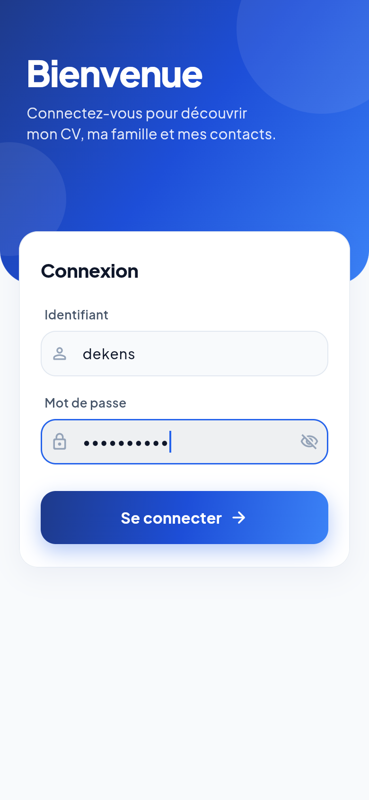
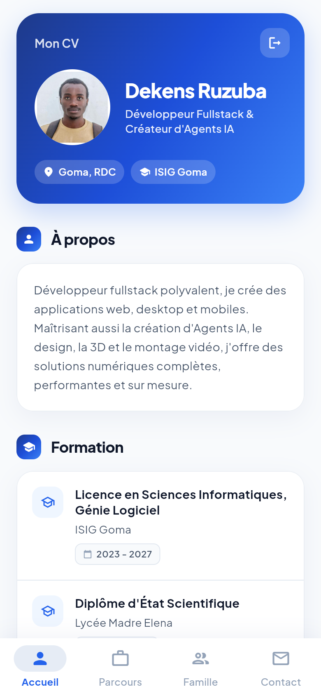
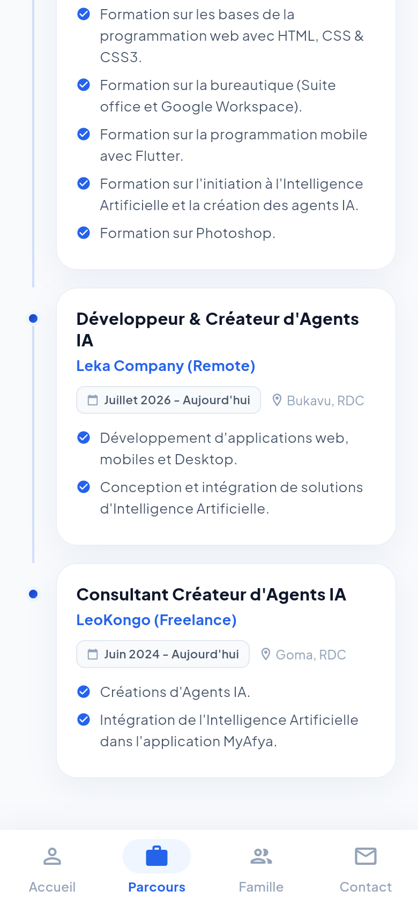
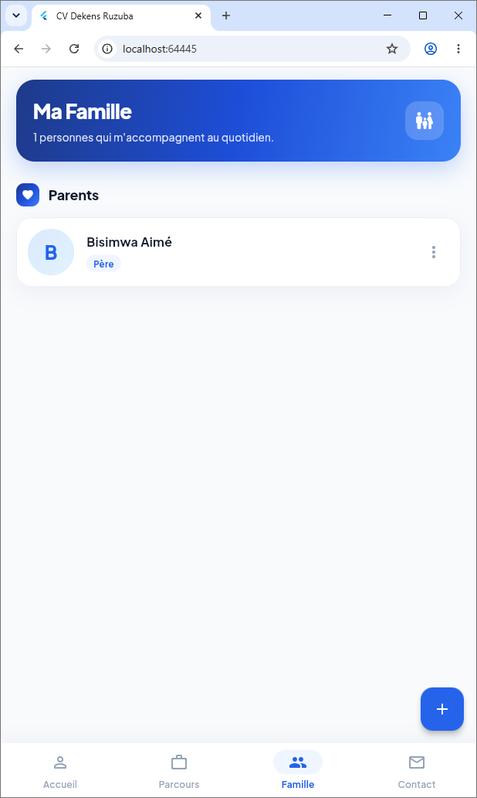
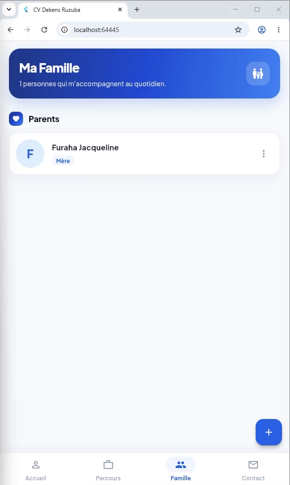
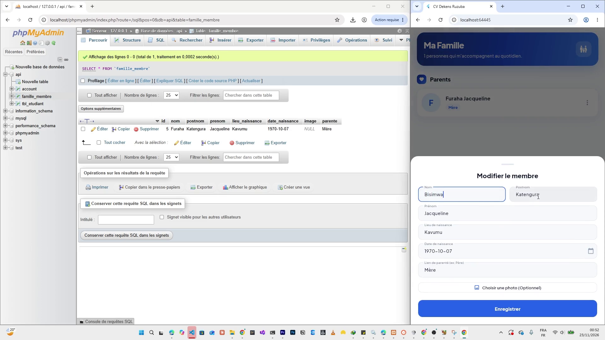

# cv_flutter_dekens – CV Dynamique de Dekens Ruzuba

Application mobile Flutter complète présentant mon CV, mon parcours, ma famille et mes coordonnées, avec une authentification réelle et une gestion dynamique des membres de la famille via une API REST et une base de données MySQL.

## Fonctionnalités

- **Connexion sécurisée** : Authentification via l'API avec email et mot de passe.
- **Accueil (CV)** : Présentation, formation, compétences techniques, langues et centres d'intérêt.
- **Parcours** : Expériences professionnelles présentées sous forme de frise chronologique.
- **Famille (CRUD)** : Liste dynamique (API) des membres. Vous pouvez **ajouter, modifier et supprimer** des membres, avec possibilité de **téléverser une photo** et de sélectionner une date de naissance via un calendrier.
- **Contact** : Coordonnées et réseaux sociaux cliquables (via `url_launcher`).
- **Navigation** : `NavigationBar` fluide (Accueil, Parcours, Famille, Contact).

## Identifiants de test

| Identifiant (Email) | Mot de passe |
|-------------|--------------|
| `dekens@exemple.com` | `dekens2026` |

*(Si ce compte n'existe pas, créez-le via Postman sur la route `/accounts/register` de l'API)*.

## Configuration requise

### 1. Base de données & API (XAMPP)
1. Démarrez **Apache** et **MySQL** depuis XAMPP.
2. Ouvrez `http://localhost/phpmyadmin`, créez une base `api` et importez le fichier `api.sql`.
3. Placez le dossier de l'API dans `C:\xampp\htdocs\api-test`.
4. L'API est accessible sur `http://localhost/api-test/public`.

### 2. Application Flutter
1. Clonez ce dépôt.
2. Exécutez `flutter pub get`.
3. Lancez l'application avec `flutter run`.

**Note pour l'émulateur Android** : L'URL de l'API est configurée sur `http://10.0.2.2/api-test/public`. Pour un appareil physique ou le web, modifiez la constante `kBaseUrl` dans `lib/main.dart`.

## Captures d'écran

### 1. Page de connexion

### 2. Page d'accueil (CV)
| Profil & formation | Compétences | Langues & centres d'intérêt |
|:---:|:---:|:---:|
|  |  |  |

### 3. Page Parcours
| | |
|:---:|:---:|
|  |  |

### 4. Page Famille (Dynamique API)
### Liste des membres :

### Formulaire d'ajout / modification :

### 5. Page Contact

### 6. Base de données MySQL (phpMyAdmin)

---

## Vidéo de démonstration

*Vidéo montrant l'application Flutter communiquer avec l'API et la base de données en temps réel.*

<video src="video/video_dekens.mp4" controls="controls" style="max-width: 100%;">
Votre navigateur ne supporte peut-être pas la balise vidéo.
</video>

*Si la vidéo ne s'affiche pas, [téléchargez-la ici](screenshots/video_demo.mp4).*

##

**Par Dekens Ruzuba** – Développeur Fullstack & Créateur d'Agents IA, Goma (RDC)
Portfolio : [Dekens Ruzuba](https://portfoliodek.netlify.app/)