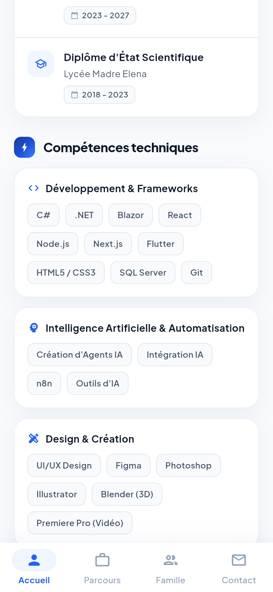
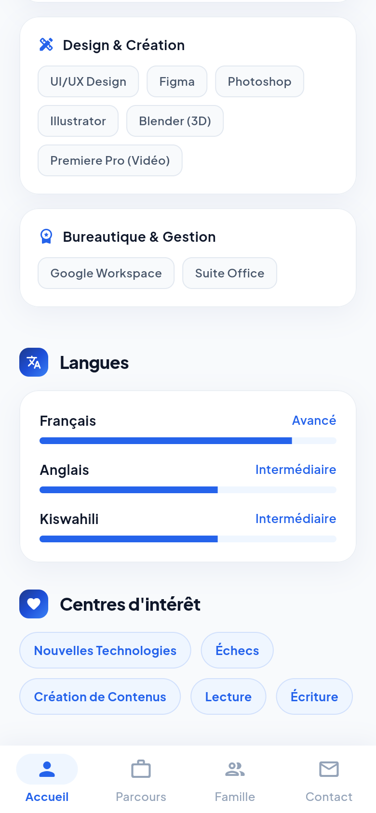
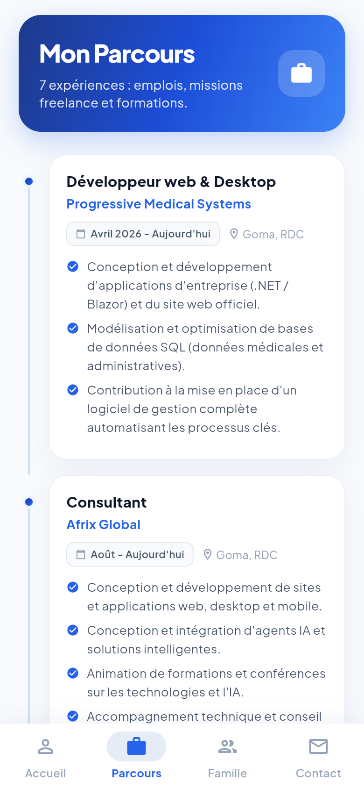
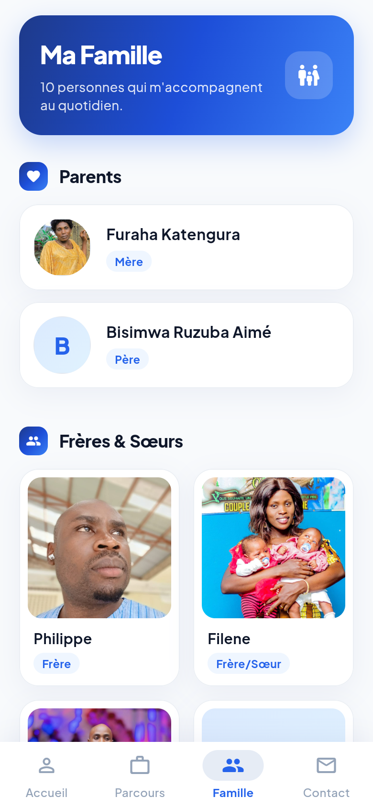
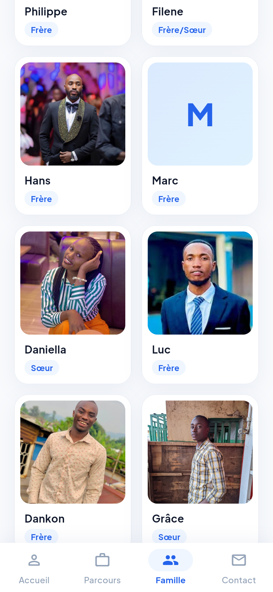
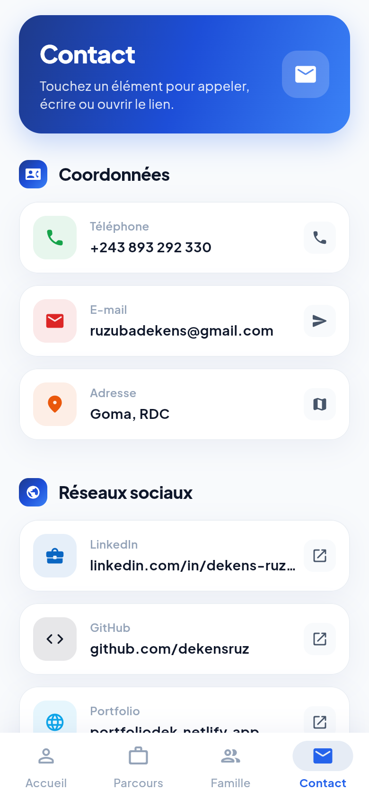

# cv_flutter_dekens – CV de Dekens Ruzuba

Application mobile Flutter qui présente mon CV, ma famille et mes coordonnées.
L'accès à l'application se fait par une page de connexion.

## Fonctionnalités

- **Connexion** : formulaire avec identifiant, mot de passe masqué (affichable via l'icône œil) et bouton « Se connecter ». Un message d'erreur s'affiche si les identifiants sont incorrects.
- **Accueil (CV)** : photo, nom, titre, présentation, formation, compétences techniques, langues (avec niveau) et centres d'intérêt.
- **Parcours** : expériences professionnelles (emplois, missions freelance, formations données) présentées sous forme de frise chronologique.
- **Famille** : parents et frères & sœurs avec photo, nom et lien de parenté, affichés avec des `Card` et une `GridView`.
- **Contact** : téléphone, e-mail, adresse, LinkedIn, GitHub et portfolio. Chaque élément est **cliquable** : il lance un appel, ouvre un e-mail, la carte ou le lien (via `url_launcher`).
- **Navigation** : une `NavigationBar` en bas de l'écran (Accueil, Parcours, Famille, Contact) et un bouton de déconnexion.

## Identifiants de test

| Identifiant | Mot de passe |
|-------------|--------------|
| `dekens`    | `dekens2026` |

## Captures d'écran

### 1. Page de connexion


### 2. Page d'accueil (CV)

| Profil & formation | Compétences | Langues & centres d'intérêt |
|:---:|:---:|:---:|
|  |  |  |

### 3. Page Parcours (expériences)

| | |
|:---:|:---:|
|  |  |

### 4. Page Famille

| Parents | Frères & sœurs |
|:---:|:---:|
|  |  |

### 5. Page Contact



## Technologies

- Flutter / Dart (Material 3)
- [`google_fonts`](https://pub.dev/packages/google_fonts) : police Plus Jakarta Sans
- [`url_launcher`](https://pub.dev/packages/url_launcher) : appels, e-mails et liens

## Lancer le projet

```bash
flutter pub get
flutter run
```

## Auteur

**Dekens Ruzuba** – Développeur Fullstack & Créateur d'Agents IA, Goma (RDC)
GitHub : [dekensruz](https://github.com/dekensruz)
